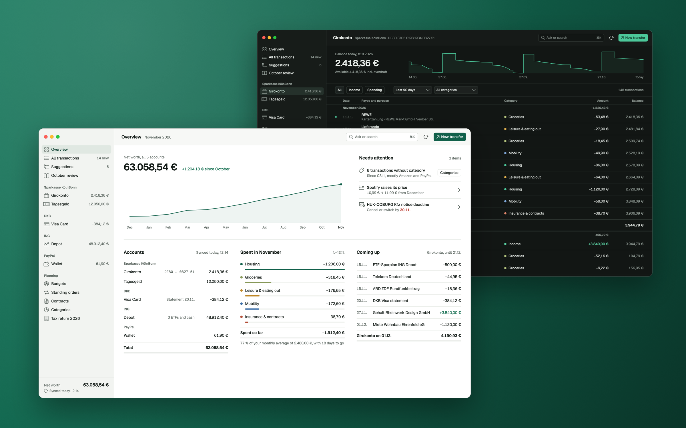

<p align="center">
  
</p>

<h1 align="center">IMM — Ich mag Moneten</h1>

<p align="center">
  A local-first personal finance app for the Mac.<br>
  All your accounts in one encrypted ledger on your Mac. No server, no account, no tracking.
</p>

<p align="center">
  <a href="https://github.com/RobinGasi/IMM/actions/workflows/ci.yml"></a>
  
  
  <a href="LICENSE"></a>
</p>

> [!IMPORTANT]
> **Early preview (0.1.0).** IMM cannot talk to real banks yet. The only bank connection is a demo bank that loads a sample ledger, so everything in the screenshot is made-up data. A FinTS connector for German banks comes next.

## What IMM does

- **Overview** of net worth, spending this month against your average, upcoming payments and what needs attention.
- **Transactions** for every account or all of them, with running balances, filters, search and an inspector for categories, notes and rules.
- **Budgets, standing orders, contracts, a depot, categories,** a monthly review and a tax-return overview, all computed from one ledger.
- **Transfers and scheduled payments** with TAN approval (simulated by the demo bank).
- **Your data stays yours:** one encrypted `.imm` database you create and unlock with a password or Touch ID. IMM locks itself after inactivity or when your Mac sleeps.
- **Sync between your own devices** over [Tailscale](https://tailscale.com), end-to-end encrypted, with an optional encrypted iCloud relay for when the other device is asleep. The Mac never listens on your Wi-Fi.
- Native SwiftUI, light and dark appearance, window sizes down to 1024 × 720.

## Status and limitations

- **Bank access is a demo connector**, there for development and screenshots: every bank in the list answers, any login works, and finishing onboarding loads one sample ledger with five accounts. Payments are approved after three seconds and booked. FinTS, then file import, are planned.
- **The demo ledger treats 12.11.2026 as "today"** while the database holds only demo data. Lock timers and sync times use the real clock.
- **AI screens show stored content.** Ask, Suggestions, the monthly review, Pay invoice and Tax return display prepared content; no model runs and no PDF is read.
- **Some controls are placeholders.** Controls without a working target look as designed, do nothing and show the tooltip "Not available in this version". In Settings only Security and Sync work.
- English UI with German money and date formats.

## Security model

- **Database package.** `<name>.imm/` contains `vault.json` (plaintext header) and `data.sqlite` (SQLCipher).
- **Password.** Argon2id (libsodium, 64 MiB, 3 iterations) over the NFC-normalised password gives a key-encryption key that wraps a random 256-bit data key with AES-256-GCM; the header fields are authenticated. At least 8 characters. There is no recovery.
- **Database key.** HKDF-SHA256 of the data key, salted with the vault ID. Changing the password re-wraps the data key and leaves the database untouched.
- **Touch ID.** The data key can also live in the Keychain with `.biometryCurrentSet` and `WhenUnlockedThisDeviceOnly`: fingerprint only, never the Mac login password. After your fingerprints change, the password is needed once. Requires a signed build.
- **Auto-lock** after 1, 5 (default), 15 or 60 minutes without input in IMM, or never; optionally at once on sleep, display sleep, screen lock and user switch. Locking closes the database and wipes the keys. Quitting locks.
- **Banking PINs** go to the macOS Keychain only if you tick "Store PIN in macOS Keychain".
- **Sandbox and hardened runtime** are always on. A database in a cloud-synced folder (iCloud Drive, Dropbox …) triggers a warning, because syncing an open SQLite database can corrupt it.

### Sync

- **No conflicts to resolve.** Every edit carries a hybrid logical clock; per field the newer edit wins and the older one stays on the device for undo. Bookings get ids computed from their content, so two devices that fetch the same booking store one row. Deletions are kept as markers and never come back.
- **Pairing** shows a QR code and a typed code on the Mac; both devices then show a 6-digit code you compare (commit-then-reveal, so it cannot be forced). Sessions use the [Noise protocol](https://noiseprotocol.org) (`XXpsk3` to pair, `IK` afterwards) with keys pinned at pairing.
- **End-to-end encryption.** Every batch of changes is sealed with XChaCha20-Poly1305 under a group key that only your paired devices hold. Removing a device replaces the key.
- **Only on your tailnet.** A small helper inside IMM listens on the Mac's Tailscale address only and keeps sealed batches for devices that are offline; it holds no key that can open them. It is off until you turn on "Sync over Tailscale".
- **iCloud relay** (optional, signed builds): sealed batches also go to your private iCloud database, so a device that was asleep catches up. Apple sees only ciphertext.

## Build and run

There is no signed download yet. Build it yourself with Xcode 27 on macOS 26 or later:

```sh
brew install xcodegen
export DEVELOPER_DIR=/Applications/Xcode.app/Contents/Developer
xcodegen generate
xcodebuild -project IMM.xcodeproj -scheme IMM -configuration Debug-Unsigned \
  -destination 'platform=macOS' -derivedDataPath build/dd build
open -n build/dd/Build/Products/Debug-Unsigned/IMM.app --args -IMMDemoVault YES
```

`-IMMDemoVault YES` opens a demo database (password `demo-demo`) with the sample ledger. The unsigned build needs no Apple account; it lacks Touch ID and the iCloud relay. Signed builds, tests, the release script and forking are covered in [BUILDING.md](BUILDING.md).

## Repository

| Path | Contents |
| --- | --- |
| `App/` | App target: entry point, updater, Info.plist, entitlements, icons |
| `Agent/` | The sync helper (`IMM Sync Agent.app`) and its LaunchAgent plist |
| `Packages/IMMKit/` | Swift package: `IMMVault` (encryption), `IMMLedger` (database, merge), `IMMBanking` (connectors, demo bank), `IMMDesign` (tokens, fonts, controls), `IMMSyncCore` and `IMMSync` (sync), `IMMUI` (screens), plus the `imm-demo-report` and `imm-sync-peer` tools |
| `Config/` | xcconfig files and export options |
| `DesignReference/` | Reference screenshots, prototype links and design tokens the tests compare against |
| `Tools/` | Token generator, string-catalog sync, release script, tailnet sync test |

## Contributing

Issues and pull requests are welcome. Please run `swift test --package-path Packages/IMMKit` before opening a pull request; CI runs the same tests. Report security problems privately through [GitHub's vulnerability reporting](https://github.com/RobinGasi/IMM/security/advisories/new), not in public issues.

## Licence

IMM is licensed under the [Mozilla Public License 2.0](LICENSE).

The Geist and Geist Mono fonts in `Packages/IMMKit/Sources/IMMDesign/Resources/Fonts/` are © Vercel and licensed under the SIL Open Font License 1.1 (`OFL.txt` in the same folder).

Built on [GRDB.swift](https://github.com/groue/GRDB.swift) (via the [SQLCipher fork](https://github.com/sqlcipher/GRDB.swift)), [SQLCipher.swift](https://github.com/sqlcipher/SQLCipher.swift), [swift-sodium](https://github.com/jedisct1/swift-sodium) and [Sparkle](https://github.com/sparkle-project/Sparkle).
